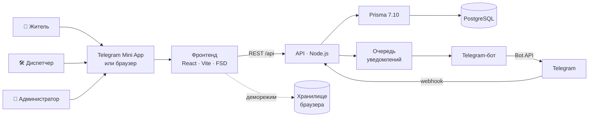
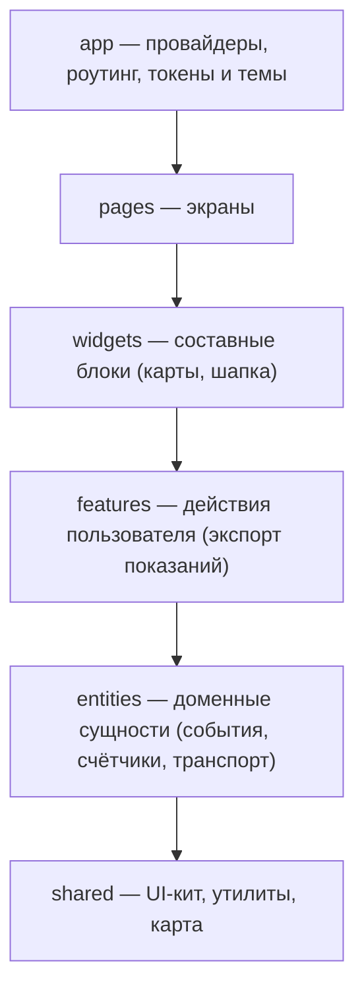
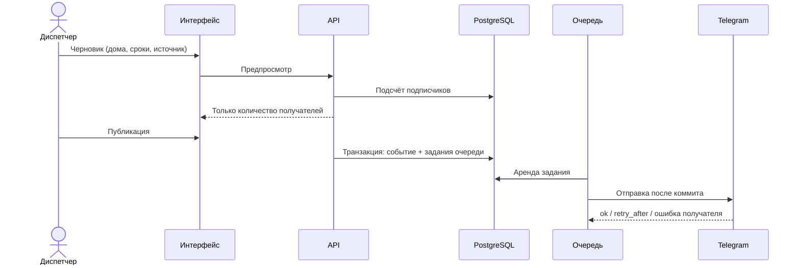
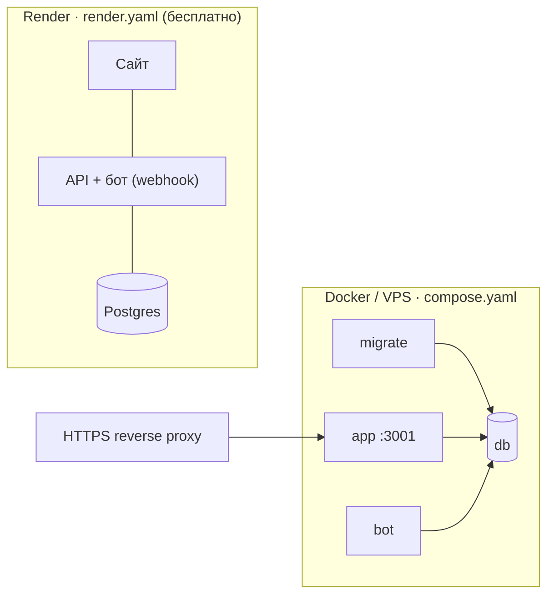

<div align="center">

# 🏙️ Мой город · DniesterCity

**Единое окно коммунальных услуг Приднестровья** — веб-приложение для жителя и диспетчера, API на Node.js, PostgreSQL и Telegram-бот.

[](#-что-нового-в-03)
[](https://moy-gorod-utilities-kirill.primekid15.chatgpt.site)
[](docs/DEPLOY-RENDER.md)


[Демо](https://moy-gorod-utilities-kirill.primekid15.chatgpt.site) · [Быстрый старт](#-быстрый-старт) · [Архитектура](#-архитектура) · [Команда](#-команда-и-роли) · [Документация](#-документация)

</div>

---

## 📑 Содержание

- [О проекте](#-о-проекте)
- [Возможности](#-возможности)
- [Архитектура](#-архитектура)
- [Команда и роли](#-команда-и-роли)
- [Быстрый старт](#-быстрый-старт)
- [Серверный пилот](#-серверный-пилот)
- [Деплой](#-деплой)
- [Конфигурация](#-конфигурация)
- [Команды npm](#-команды-npm)
- [Тестирование](#-тестирование)
- [Структура репозитория](#-структура-репозитория)
- [Границы продукта](#-границы-продукта)
- [Документация](#-документация)
- [Что нового в 0.3](#-что-нового-в-03)

---

## 🎯 О проекте

Жителю приходится искать аварийные отключения, передавать показания и обращаться в организации по разным каналам. **«Мой город»** собирает это в одном месте:

- **Житель** — видит события по своим домам, передаёт показания счётчиков, создаёт обращения.
- **Диспетчер** — публикует события, ведёт очередь обращений, видит аналитику.
- **Администратор** — управляет организациями и зонами ответственности.

Работает в двух режимах:

| Режим | Данные | Для чего |
|---|---|---|
| **Демо** | Учебные, хранятся в браузере | Показ, защита, проверка интерфейса. Запускается без `.env` |
| **Сервер** | PostgreSQL через Prisma, вход через Telegram | Пилот с реальными пользователями |

> 🔗 **Демо:** <https://moy-gorod-utilities-kirill.primekid15.chatgpt.site> — приватный интерфейс с учебными данными. Сервер, бот и PostgreSQL на демо-хостинге не работают: он статический.

---

## ✨ Возможности

**Для жителя**
- 8 направлений: электричество, холодная и горячая вода, газ, отопление, канализация, вывоз отходов, обслуживание дома.
- Несколько адресов; уведомления настраиваются по категориям для каждого дома.
- События с источником, сроками и историей изменений; честный статус «Срок неизвестен»; поиск, фильтры, архив.
- Несколько счётчиков одной услуги (заводской номер, лицевой счёт, своя история). Проверка периода, дубликатов и уменьшения значения; график расхода и экспорт CSV.
- Обращения: приоритет, история, последовательные статусы, повторное открытие.
- Раздел «Транспорт»: ближайшая маршрутка по времени ПМР, линия и остановки на карте, оценка цены такси, кто работает сейчас.
- Карта с пинами услуг, «Где я», легендой и тёмными тайлами.

**Для диспетчера и администратора**
- События на несколько домов, черновики, проверка и предпросмотр. Предпросмотр считает подписчиков без раскрытия их данных.
- Очередь обращений с фильтрами, графики, управление событиями.
- Организации и зоны ответственности с проверкой пересечений.

**Интерфейс**
- Светлая и тёмная темы на дизайн-токенах, 3 акцента, шрифты Inter + Montserrat.
- Анимации framer-motion (отключаются системной настройкой «уменьшить движение»).
- Свои выпадающие списки: клавиатура, ARIA. Мобильная нижняя навигация, модальные окна шторкой.
- Проверка WCAG AA автотестом (axe).

> 🛡️ **«Режим защиты»** — четыре действия создают помеченные учебные записи и показывают путь от черновика до принятой заявки.

---

## 🏗️ Архитектура

### Общая схема



В режиме `BOT_MODE=webhook` бот и очередь уведомлений работают внутри процесса API. Отдельный процесс (`npm run bot`) остаётся для Docker и VPS.

### Слои фронтенда (Feature-Sliced Design)



Импорты идут только вниз. У каждой страницы публичный `index.ts`. Псевдоним путей — `@/`.

### Путь события: от черновика до Telegram



Гарантия доставки — **at-least-once**: при потере подтверждения Telegram сообщение может прийти повторно.

### Варианты развёртывания



### Принципы

- **Доступ.** Вход только через подписанные данные Telegram. Роль проверяется при каждом запросе, поэтому отозванный доступ не живёт в старом токене.
- **Данные.** Схема в `prisma/`, миграции версионируются, тесты идут на PGlite с теми же миграциями.
- **Адресность.** Подписка на адрес не подтверждает владение и не открывает чужие показания и обращения.

Подробно — [docs/ARCHITECTURE.md](docs/ARCHITECTURE.md).

---

## 👥 Команда и роли

> Заполните столбец «Участник» ФИО или ссылкой на GitHub.

| Роль | Участник | Зона ответственности | Результат в репозитории |
|---|---|---|---|
| 🧭 **Founder / Product Owner** | _укажите_ | Идея, границы продукта, приоритеты версий, честные ограничения («что не имитируется»), защита проекта | Раздел [«Границы продукта»](#-границы-продукта), [DEFENSE.md](docs/DEFENSE.md) |
| 📊 **Бизнес-аналитик** | _укажите_ | Роли и сценарии, Customer Journey Map, правила статусов и сроков, метрики пилота, руководство пользователя | [CJM](docs/CJM.md) · [визуальная версия](docs/cjm.html) · [MANUAL.md](docs/MANUAL.md) |
| 🎨 **Дизайнер** | _укажите_ | Визуальный язык (DniesterWorks), светлая и тёмная темы, токены, контрасты WCAG AA, состояния интерфейса, мобильная адаптация | `src/app/styles/tokens.css`, слой `dw.css` |
| 💻 **Frontend-разработчик** | _укажите_ | React-приложение на FSD, формы и валидация, карты, раздел «Транспорт», анимации, свои компоненты (Select), деморежим | `src/` (`app · pages · widgets · features · entities · shared`) |
| ⚙️ **Backend-разработчик** | _укажите_ | API, авторизация через Telegram, роли и права, очередь уведомлений, Telegram-бот и webhook, CLI для первоначальной настройки | `build/server/` после сборки, `provision.example.json` |
| 🗄️ **Администратор БД** | _укажите_ | Схема Prisma, миграции (`0_init`, перенос данных 0.1), CHECK/GIN-индексы, блокировки, baseline для баз версии 0.2 | `prisma/`, [MIGRATIONS.md](docs/MIGRATIONS.md) |
| 🖥️ **Системный администратор** | _укажите_ | Docker и `compose.yaml`, Render Blueprint, HTTPS-прокси, переменные окружения, секреты, бэкапы | `Dockerfile`, `compose.yaml`, `render.yaml`, [DEPLOY-RENDER.md](docs/DEPLOY-RENDER.md) |
| 🧪 **QA-инженер** | _укажите_ | Тест-план, юнит, SQL/HTTP и e2e тесты, проверка доступности, отчёт о качестве | `e2e/`, `playwright.config.ts`, [QA-REPORT.md](docs/QA-REPORT.md) |

**Как организована работа.** Каждый шаг разработки — отдельный коммит. После каждого шага запускались `tsc`, юнит-тесты и e2e.

---

## 🚀 Быстрый старт

**Демо без сервера и базы данных.** Требуется Node.js **22.12+** (сборка проверена на Node.js 24).

```bash
git clone https://github.com/suxxesz/dniester-city.git
cd dniester-city/dniester-city

npm ci
npm run db:generate   # Prisma Client — нужен и для тестов, и для сервера
npm run dev
```

Откройте <http://127.0.0.1:5173>. Без `.env` включается деморежим:

- Кнопка **«Панель диспетчера»** переключает учебную роль прямо в браузере.
- Стартовые данные: Тирасполь, ул. Ленина, 18, несколько событий, счётчики и учебное обращение.
- В настройках демо можно сбросить.

---

## 🧩 Серверный пилот

### Что понадобится

Токен Telegram-бота, PostgreSQL, HTTPS-сервер, случайная строка `SESSION_SECRET` (от 32 символов).

### Шаги

1. Скопируйте `.env.example` в `.env` и заполните переменные ([таблица ниже](#-конфигурация)).
2. Установите `VITE_DATA_MODE=server`. Если интерфейс и API на одном origin, `VITE_API_URL` оставьте пустым.
3. Запустите базу и приложение:

   ```bash
   docker compose up -d db
   npm run db:migrate      # prisma migrate deploy
   npm run build
   npm run server:prod
   ```

4. Запустите бота — в отдельном терминале `node build/server/bot.mjs`, либо `BOT_MODE=webhook` + `PUBLIC_URL`, тогда бот работает внутри API.
5. Настройте HTTPS reverse proxy на `127.0.0.1:3001`. Этот публичный адрес укажите в `MINI_APP_URL` и в настройках бота.
6. Открывайте приложение **кнопкой бота**: обычный переход без подписанных данных Telegram не авторизует пользователя.

> При первом входе создаётся пустой личный кабинет. Демо-события в серверную базу не загружаются.

**Для разработки:** запускайте одновременно `npm run dev` и `npm run server`. Vite проксирует `/api` на порт 3001.

**База версии 0.2 (до Prisma):** один раз выполните `npm run db:baseline`, затем `npm run db:migrate`.

### Администраторы и диспетчеры

- `ADMIN_TELEGRAM_IDS` задаёт администраторов только **при создании** пользователей. Изменить или отозвать существующую роль может оператор в БД.
- Организации и зоны редактируются в панели администратора. Для первой настройки есть CLI:

  ```bash
  npm run provision -- provision.example.json
  ```

  Замените учебные значения. Чтобы назначить диспетчера после его первого входа через Telegram, добавьте в `dispatchers` объект `{"telegramId":123456789,"organizationId":"water-pilot"}`.

---

## ☁️ Деплой

### Render (бесплатно, один Blueprint)

`render.yaml` в корне поднимает сайт, API, бота (webhook) и Postgres. Пошагово — [docs/DEPLOY-RENDER.md](docs/DEPLOY-RENDER.md).

### Docker / VPS

В `compose.yaml` есть профиль `pilot`:

```bash
docker compose --profile pilot build
docker compose up -d db
docker compose --profile pilot run --rm migrate
docker compose --profile pilot up -d app bot
```

- База хранится в volume `city_data`.
- Приложение слушает только локальный порт `3001`. Внешний доступ организуется через HTTPS-прокси.
- ⚠️ Dockerfile подготовлен, но образ в окружении разработки не собирался: Docker daemon был недоступен.

---

## ⚙️ Конфигурация

| Переменная | Назначение |
|---|---|
| `BOT_TOKEN` | Токен Telegram-бота |
| `MINI_APP_URL` | Публичный HTTPS-адрес приложения |
| `DATABASE_URL` | Строка подключения PostgreSQL. Вне локального теста замените пароль |
| `SESSION_SECRET` | Случайная строка от 32 символов |
| `VITE_DATA_MODE` | `server` для серверного режима, иначе демо |
| `VITE_API_URL` | Адрес API. Пусто, если интерфейс и API на одном origin |
| `ADMIN_TELEGRAM_IDS` | Telegram ID администраторов (применяется при создании пользователей) |
| `BOT_MODE` | `webhook` — бот внутри API (нужен `PUBLIC_URL`) |
| `PUBLIC_URL` | Публичный адрес API для webhook |

---

## 📜 Команды npm

| Команда | Что делает |
|---|---|
| `npm ci` | Установка зависимостей |
| `npm run dev` | Интерфейс (Vite) на `:5173` |
| `npm run server` | API в режиме разработки |
| `npm run build` | Сборка: `dist/` и модули Node.js в `build/server/` |
| `npm run server:prod` | Запуск собранного API (tsx не нужен) |
| `npm run bot` | Бот отдельным процессом (Docker/VPS) |
| `npm run db:generate` | Генерация Prisma Client |
| `npm run db:migrate` | `prisma migrate deploy` |
| `npm run db:baseline` | Разовая постановка на миграции для базы версии 0.2 |
| `npm run provision -- <файл>` | Первоначальная настройка организаций и диспетчеров |
| `npm test` | Типы и юнит-тесты |
| `npm run test:e2e` | Браузерные сценарии (Playwright) |
| `npm run format` | Форматирование исходников |

---

## 🧪 Тестирование

| Уровень | Что проверяется |
|---|---|
| **Типы** | Включая неиспользуемый код; версии зависимостей зафиксированы |
| **Домен** | Показания, отдельные счётчики, черновики, версии событий, зоны организаций |
| **SQL** | PGlite + Prisma на тех же миграциях: права, адресные уведомления, перенос истории версии 0.1 |
| **HTTP** | Подписанные данные Telegram, вход, отзыв роли, запрет чужого счётчика, предпросмотр подписчиков, идемпотентность |
| **Очередь** | Аренда задания, вызов сети после транзакции, `retry_after`, постоянная ошибка получателя |
| **Бот** | Webhook принимает только свой секрет |
| **Транспорт** | Ближайший рейс, оценка такси, ночные часы работы |
| **E2E** | Сценарии жителя и диспетчера, режим защиты, мобильная вёрстка, клавиатура, WCAG AA (axe) |

Браузерные тесты используют Chrome в Windows. На другой системе измените `executablePath` в `playwright.config.ts` или установите браузер Playwright и удалите этот параметр. Результаты и скриншоты лежат в `.local/` и в репозиторий не входят. Полный отчёт — [QA-REPORT.md](docs/QA-REPORT.md).

---

## 🗂️ Структура репозитория

```text
dniester-city/
├── render.yaml                 # Blueprint для Render
└── dniester-city/              # приложение
    ├── src/
    │   ├── app/                # провайдеры, роутинг, styles/tokens.css
    │   ├── pages/              # экраны
    │   ├── widgets/            # составные блоки (карты и др.)
    │   ├── features/           # действия пользователя
    │   ├── entities/           # доменные сущности
    │   └── shared/             # UI-кит, утилиты, shared/lib/map.ts
    ├── prisma/                 # schema.prisma и миграции
    ├── e2e/                    # браузерные сценарии
    ├── docs/                   # документация
    ├── compose.yaml · Dockerfile
    ├── playwright.config.ts
    ├── provision.example.json
    └── .env.example
```

---

## 🚧 Границы продукта

**Не имитируется:** официальное принятие показаний поставщиком, начисления и платежи. Статус «Сохранено в сервисе» не означает передачу в учётную систему организации.

**Не проверено:** реальная отправка Telegram и вход реального пользователя без токена; конкурентные процессы и нагрузка на отдельном PostgreSQL (проверки идут на встроенном движке PGlite); сборка Docker-образа.

**Карта в демо** использует условные точки.

**Для реального внедрения нужны:** токен бота, доступный PostgreSQL, HTTPS-сервер, назначенные ответственные сотрудники и проверенные источники данных, резервные копии, политика хранения данных, мониторинг очереди, распределённое ограничение запросов для нескольких серверов.

**Следующие этапы:** адресный классификатор и реальные координаты домов, подтверждённые аварийные контакты, фото с закрытым хранилищем, замена и обнуление счётчиков, тарифные зоны, черновики из парсеров официальных источников, официальный приём показаний, начисления и платежи.

---

## 📚 Документация

| Документ | Для кого | О чём |
|---|---|---|
| [ARCHITECTURE.md](docs/ARCHITECTURE.md) | Разработчики | Слои FSD, Prisma, границы доступа, гарантии доставки |
| [MIGRATIONS.md](docs/MIGRATIONS.md) | БД, DevOps | Миграции, baseline, перенос данных |
| [DEPLOY-RENDER.md](docs/DEPLOY-RENDER.md) | DevOps | Деплой на Render пошагово |
| [CJM.md](docs/CJM.md) · [cjm.html](docs/cjm.html) | Аналитик, дизайнер | Customer Journey Map |
| [MANUAL.md](docs/MANUAL.md) | Пользователи | Руководство |
| [QA-REPORT.md](docs/QA-REPORT.md) | QA | Отчёт о проверках |
| [DEFENSE.md](docs/DEFENSE.md) | Founder | Трёхминутный сценарий выступления, измерения пилота |

---

## 🆕 Что нового в 0.3

<details>
<summary>Список изменений</summary>

- **Дизайн в стиле DniesterWorks:** светлая и тёмная темы на единых токенах, без инверсии цветов.
- **Анимации framer-motion** с учётом «уменьшить движение».
- **Свои выпадающие списки** вместо системных (13 мест, API как у нативного `<select>`).
- **Карты:** пины услуг, «Где я», легенда, затемнение только слоя тайлов; исправлен сброс масштаба.
- **Раздел «Транспорт»:** маршрутки и такси.
- **Feature-Sliced Design** и псевдоним `@/`.
- **Prisma 7.10** вместо сырых запросов `pg`; тесты на PGlite.
- **Render:** бот в режиме webhook внутри API, один Blueprint на всё.
- **Документы:** CJM, QA-отчёт, миграции, руководство, деплой.
- **Исправлено:** тест перевода часов (в Молдове весной пропадает 02:00–02:59), обрезание верхнего меню на ноутбуках, повторное открытие списка по клику внутри `<label>`, контрасты статусов подняты до WCAG AA.

</details>
