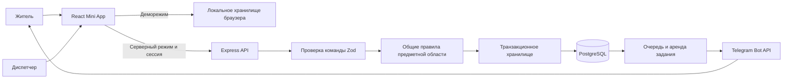

# Архитектура версии 0.2

## Границы модулей

- `src/model.ts`: типы и справочник услуг, без демоданных.
- `src/contracts.ts`: единый контракт команд, проверка обязательных полей, категорий, чисел, URL и лишних параметров.
- `src/actions.ts`: чистые правила показаний, счётчиков, статусов, черновиков и пересечения зон обслуживания. Используются локальным демо и сервером.
- `src/demo.ts`: изолированные учебные данные. Серверные правила от них не зависят.
- `src/api.ts`: адаптер серверного и локального хранения, миграция браузерной истории, таймаут и сохранение ключа повторного запроса после потери ответа.
- `src/store/CityProvider.tsx`: состояние сеанса, последовательная отправка команд, обработка ошибок и обновления. Ответ фонового запроса не перезаписывает более позднюю мутацию.
- `src/pages/`: независимые экраны; дополнительные разделы и карта загружаются по требованию.
- `src/components/`: общий интерфейс, формы, диалог с управлением фокусом, сообщения об ошибках.
- `server/app.ts`: создаваемое с внедряемым подключением к БД HTTP-приложение. Его можно проверить без запуска реального Telegram.
- `server/store.ts`: проверка владельца и организации, SQL-фильтрация, транзакции, журнал и очередь.
- `server/outbox.ts`: получение задания, аренда с токеном, освобождение транзакции до HTTP-вызова, результат и повторы.
- `server/telegram.ts`: клиент Telegram и структурированные ошибки без токена в сообщении.

## Кто видит данные

| Данные | Житель | Диспетчер | Администратор |
| --- | --- | --- | --- |
| Опубликованные события и графики | По сохранённым адресам | По адресам и зоне своей организации | Все |
| Черновики | Нет | Только своей организации и услуг | Все |
| Счётчики, показания, обращения | Только свои | Назначенные организации, услуги и адреса | Все |
| Конфигурация организаций | Видит справочник по адресу | Видит относящийся справочник | Редактирует |
| Уведомления кабинета | Только свои | Только свои | Только свои |

Подписка на адрес не доказывает проживание. Она открывает публичные события, но не личные обращения соседей. Проверка прав выполняется на сервере при каждой команде; роль из интерфейса не принимается.

## Запись данных и конкуренция

Команда проверяется до применения. Транзакция блокирует строку действующего пользователя. При редактировании события или обращения дополнительно блокируется сама запись; `expectedVersion` позволяет сообщить об устаревшей форме вместо затирания результата другого сотрудника.

`requestId` уникален в пределах пользователя. Повтор после потери ответа возвращает актуальное состояние без второй записи. На уровне БД также есть уникальный индекс показаний по владельцу, адресу, услуге, счётчику и периоду. Глобальной блокировки для всех действий жителей больше нет; отдельная advisory lock нужна только для изменения конфигурации зон организаций.

Изменение события, запись в журнал и постановка уведомлений происходят в одной транзакции. Уведомление уникально по событию, версии и получателю. Черновики не создают уведомления. Подписки проверяются по каждому адресу, включая неактивный в интерфейсе.

## Доставка уведомлений

Задание переходит из `pending` в `processing`, получает `lease_token` и срок аренды. Транзакция завершается **до** обращения к Telegram. После подтверждения записывается `sent`; при временной ошибке — повтор с увеличивающейся задержкой и учётом `retry_after`. Блокировка бота получателем и другие постоянные ошибки завершают задание как `failed`. Зависшая аренда может быть получена повторно.

Гарантия доставки — at-least-once: при успешной отправке и потере подтверждения повтор возможен. Уникальность задания не является обещанием exactly-once в стороннем API.

## Обновление версии 0.1

`npm run db:setup` выполняет SQL в транзакции и преобразует прежние показания в персональные счётчики. Для двух жителей одного дома создаются разные приборы. Повторный запуск миграции не дублирует историю. Браузерный адаптер также сохраняет прежние демоданные.

## Что не проверено этим релизом

SQL и HTTP проверены на PGlite с реальным PostgreSQL-движком. Advisory lock в однопроцессных тестах заменена, поэтому гонки нескольких серверных процессов и нагрузка на отдельном PostgreSQL требуют проверки пилотом. Тест очереди использует подставной отправитель; настоящий бот без токена не запускался. Dockerfile подготовлен, но Docker daemon в рабочем окружении не работает и образ здесь не собирался.

Перед большим запуском понадобятся пагинация истории, общая система ограничения запросов для нескольких реплик, мониторинг, резервные копии, политика хранения данных и независимая проверка доступа. Эти задачи не изображаются в демо как уже выполненные.
