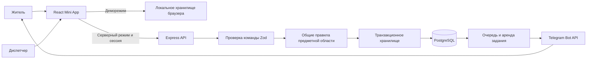

# Архитектура версии 0.2

## Границы модулей (Feature-Sliced Design)

Фронтенд разложен по слоям FSD. Слой импортирует только слои ниже себя: `app → pages → widgets → features → entities → shared`. Импорты фронтенда идут через псевдоним `@/` (= `src/`).

| Слой | Папка | Что внутри |
| --- | --- | --- |
| app | `src/app/` | Точка входа `main.tsx`, оболочка `App.tsx` (меню, шапка, роутинг по hash), стили: `styles/tokens.css` (цвета тем), `style.css` (базовая вёрстка), `dw.css` (слой в стиле DniesterWorks), `map.css`, `city-art.css` |
| pages | `src/pages/<раздел>/` | Экраны: dashboard, events, readings, tickets, complaints, schedule, organizations, transport, settings, dispatcher, pitch. У каждого `index.ts` — публичный API, вёрстка в `ui/` |
| widgets | `src/widgets/` | Крупные блоки: `modal-host` (все диалоги), `map` (карта событий, карта жалоб, карта маршрута) |
| features | `src/features/` | Действия пользователя: `export-readings` (CSV для Excel) |
| entities | `src/entities/city/` | Домен города: `model/types.ts` (типы и справочник услуг), `model/contracts.ts` (контракт команд на Zod), `model/actions.ts` (чистые правила, общие для демо и сервера), `model/demo.ts` (учебные данные), `model/store.tsx` (состояние сеанса), `api/client.ts` (сервер или localStorage), `ui/` (иконки услуг, статус, карточка события, выбор услуги) |
| | `src/entities/transport/` | Справочник маршруток и такси, ближайший рейс, оценка цены |
| shared | `src/shared/` | `ui/` (заголовки, пустые состояния, свой `Select`, логотип, ErrorBoundary), `lib/` (даты в часовом поясе Кишинёва, тема, навигация, карта Leaflet) |

Сервер:

- `server/app.ts` — Express-приложение, в которое передаётся Prisma Client; проверяется без реального Telegram.
- `server/store.ts` — права владельца и организации, фильтрация на уровне БД, транзакции, журнал и очередь.
- `server/db.ts` — создание Prisma Client поверх `@prisma/adapter-pg`, тип `Db` (клиент или транзакция), распознавание нарушения уникальности.
- `server/outbox.ts` — аренда задания, транзакция закрывается до HTTP-вызова, повторы.
- `server/bot.ts` — отдельный процесс бота (long polling); `server/bot-core.ts` — общий ответ на /start и цикл очереди; режим webhook для Render включается в `server/index.ts`.
- `server/telegram.ts` — клиент Telegram и ошибки без токена в тексте.
- `prisma/schema.prisma` + `prisma/migrations/` — схема БД и её история (см. [MIGRATIONS.md](MIGRATIONS.md)).

## Работа с базой через Prisma

Обычные чтения и записи — методы моделей Prisma (`upsert`, `createMany({ skipDuplicates })`, `updateMany`). То, что ORM не выражает, написано типобезопасным `$queryRaw` с параметрами (не склейкой строк): операторы jsonb `?|` и `?`, `SELECT … FOR UPDATE`, `FOR UPDATE SKIP LOCKED` в очереди и `pg_advisory_xact_lock` для конфигурации зон. Мутация целиком выполняется в `prisma.$transaction`, при любой ошибке откатывается.

## Кто видит данные

| Данные | Житель | Диспетчер | Администратор |
| --- | --- | --- | --- |
| Опубликованные события и графики | По сохранённым адресам | По адресам и зоне своей организации | Все |
| Черновики | Нет | Только своей организации и услуг | Все |
| Счётчики, показания, обращения | Только свои | Назначенные организации, услуги и адреса | Все |
| Конфигурация организаций | Видит справочник по адресу | Видит относящийся справочник | Редактирует |
| Уведомления кабинета | Только свои | Только свои | Только свои |

Подписка на адрес не доказывает проживание. Она открывает публичные события, но не личные обращения соседей. Проверка прав выполняется на сервере при каждой команде; роль из интерфейса не принимается.

## Запись данных и конкуренция

Команда проверяется до применения. Транзакция блокирует строку действующего пользователя. При редактировании события или обращения дополнительно блокируется сама запись; `expectedVersion` позволяет сообщить об устаревшей форме вместо затирания результата другого сотрудника.

`requestId` уникален в пределах пользователя. Повтор после потери ответа возвращает актуальное состояние без второй записи. На уровне БД также есть уникальный индекс показаний по владельцу, адресу, услуге, счётчику и периоду. Глобальной блокировки для всех действий жителей больше нет; отдельная advisory lock нужна только для изменения конфигурации зон организаций.

Изменение события, запись в журнал и постановка уведомлений происходят в одной транзакции. Уведомление уникально по событию, версии и получателю. Черновики не создают уведомления. Подписки проверяются по каждому адресу, включая неактивный в интерфейсе.

## Доставка уведомлений

Задание переходит из `pending` в `processing`, получает `lease_token` и срок аренды. Транзакция завершается **до** обращения к Telegram. После подтверждения записывается `sent`; при временной ошибке — повтор с увеличивающейся задержкой и учётом `retry_after`. Блокировка бота получателем и другие постоянные ошибки завершают задание как `failed`. Зависшая аренда может быть получена повторно.

Гарантия доставки — at-least-once: при успешной отправке и потере подтверждения повтор возможен. Уникальность задания не является обещанием exactly-once в стороннем API.

## Обновление версии 0.1

Миграция `1_legacy_meters` (её применяет `npm run db:migrate`) преобразует прежние показания в персональные счётчики. Для двух жителей одного дома создаются разные приборы. Повторный запуск миграции не дублирует историю. Браузерный адаптер также сохраняет прежние демоданные.

## Что не проверено этим релизом

SQL и HTTP проверены на PGlite с реальным PostgreSQL-движком. Advisory lock в тестах выполняется на PGlite в одном процессе, поэтому гонки нескольких серверных процессов и нагрузка на отдельном PostgreSQL требуют проверки пилотом. Тест очереди использует подставной отправитель; настоящий бот без токена не запускался. Dockerfile подготовлен, но Docker daemon в рабочем окружении не работает и образ здесь не собирался.

Перед большим запуском понадобятся пагинация истории, общая система ограничения запросов для нескольких реплик, мониторинг, резервные копии, политика хранения данных и независимая проверка доступа. Эти задачи не изображаются в демо как уже выполненные.
